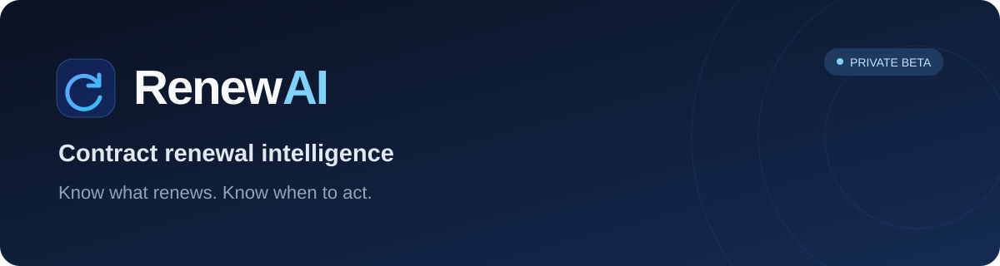

<p align="center">
  
</p>

<p align="center">
  Turn contract terms into clear deadlines, informed decisions, and a renewal plan.
</p>

<p align="center">
  <a href="https://renewai-psi.vercel.app"><strong>Open RenewAI ↗</strong></a>
  &nbsp; · &nbsp;
  <a href="#how-it-works">How it works</a>
  &nbsp; · &nbsp;
  <a href="docs/development.md">Developer guide</a>
</p>

<p align="center">
  
  
  
  
</p>

---

## Make the next renewal a decision

Contracts hide important dates and obligations in dense language. RenewAI helps
teams understand what renews, when they need to act, and which commercial terms
deserve attention—before an unwanted renewal becomes another commitment.

It is an independently built, production-deployed SaaS product in **private beta**,
designed for founder-led pilots and customer feedback.

> **RenewAI recommends. The organization decides.**

## What you can do

- **Review the terms that matter.** Extract vendor and customer names, dates,
  notice requirements, value, and commercial clauses from text-readable PDFs.
- **Find the next actionable deadline.** Calculate renewal cycles and cancellation
  windows with deterministic calendar logic, including calendar-month notice periods.
- **See what needs attention.** Review live countdowns, timing risk, upcoming
  deadlines, and tracked contract value across a workspace.
- **Make an informed decision.** Read advisory AI findings, record your own renewal
  decision, and retain decision history.
- **Keep work organized.** Use the renewal work queue, reminder schedules, and
  archive/restore controls.
- **Share a concise summary.** Download an authenticated PDF summary of reviewed
  terms, saved renewal information, and existing recommendations.

## How it works

```text
Upload a PDF → Review and correct → Save the contract
                                         ↓
                         Calculated deadlines + AI advice
                                         ↓
                           Your decision + renewal work
```

**Human review comes first.** Extracted terms are provisional until reviewed.
Unknown terms stay unknown. AI interprets language; deterministic code calculates
dates. Contract saving is independent of advisory AI analysis, so an insight
failure does not undo a confirmed save.

## Built with

**Interface** · Next.js 16, React 19, TypeScript, Tailwind CSS 4<br>
**API & intelligence** · FastAPI, Python, PyMuPDF, Groq<br>
**Data & identity** · Supabase Auth, PostgreSQL, organization-scoped access<br>
**Hosting** · Vercel frontend, Render API

The browser authenticates with Supabase and sends authenticated requests to
FastAPI. The backend scopes records to the verified workspace, extracts PDF text,
calculates renewal dates, and requests advisory analysis from the selected AI provider.

## Explore the project

- [Development and operations](docs/development.md) — architecture, local setup,
  environment variables, validation, and deployment.
- [Pilot readiness](docs/pilot-readiness.md) — monitoring, activation measurement,
  usability sessions, and device-testing checklist.
- [PDF workflow](docs/pdf-workflow.md) — supported inputs, source grounding,
  human review, and summary export.
- [Contract data safety](docs/contract-data-safety.md) — workspace boundaries,
  permanent deletion, and database release checks.
- [Reminder delivery](docs/reminder-delivery.md) — scheduling, guarded dispatch,
  and operational recovery.

## Beta scope

Text-readable PDFs are supported; image-only scans need OCR outside the app.
Original PDFs and full extracted text are processed in memory, rather than
stored as a document archive. Review ambiguous terms against the signed agreement.

Physical iPhone/Android checks and reminder-delivery follow-up remain pending.
Workflow monitoring currently supports manual log review; automatic incident alerts
are not configured. RenewAI does not provide legal advice or autonomously cancel
or negotiate agreements.

---

Built by [Raj Bhardwaj](https://github.com/RajBhardwaj29) · Founder & AI Engineer
